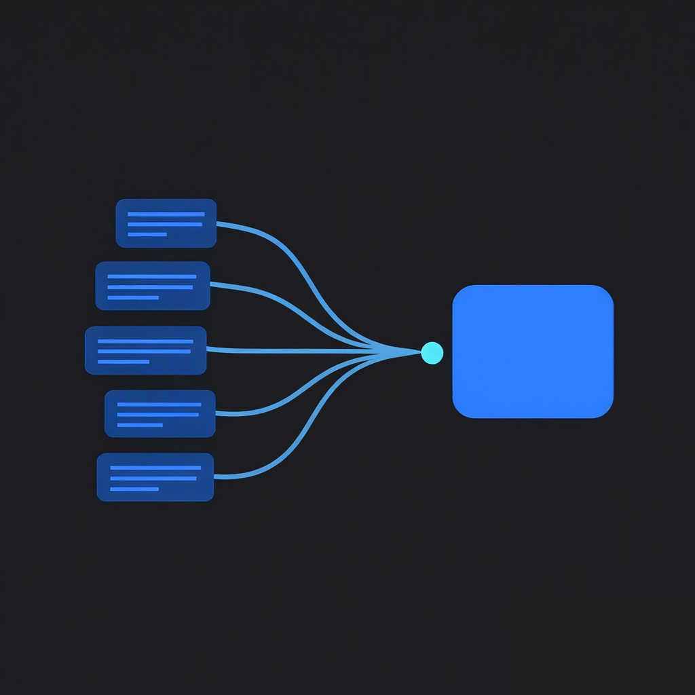
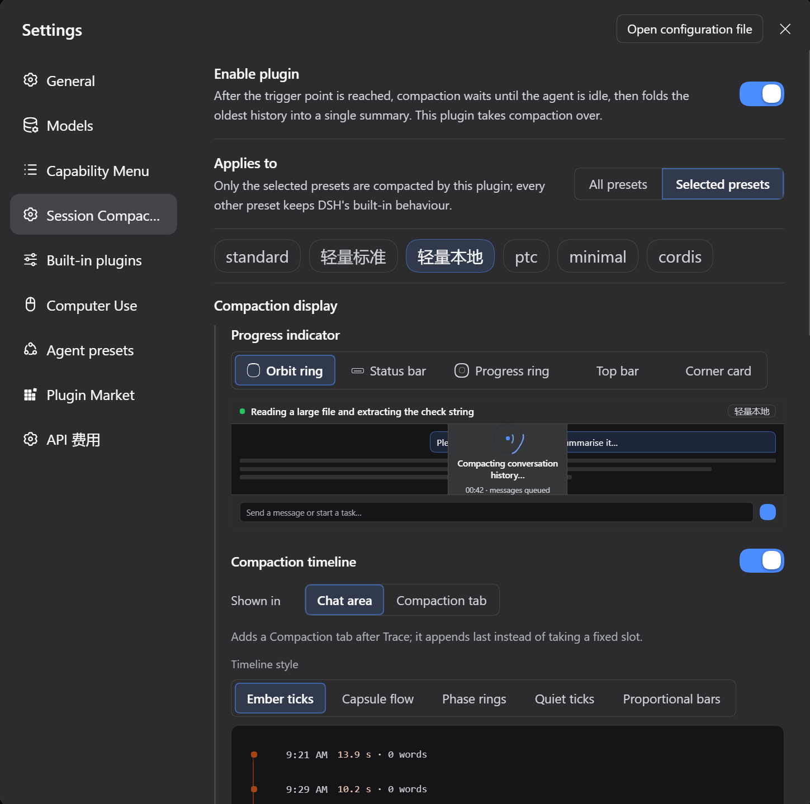
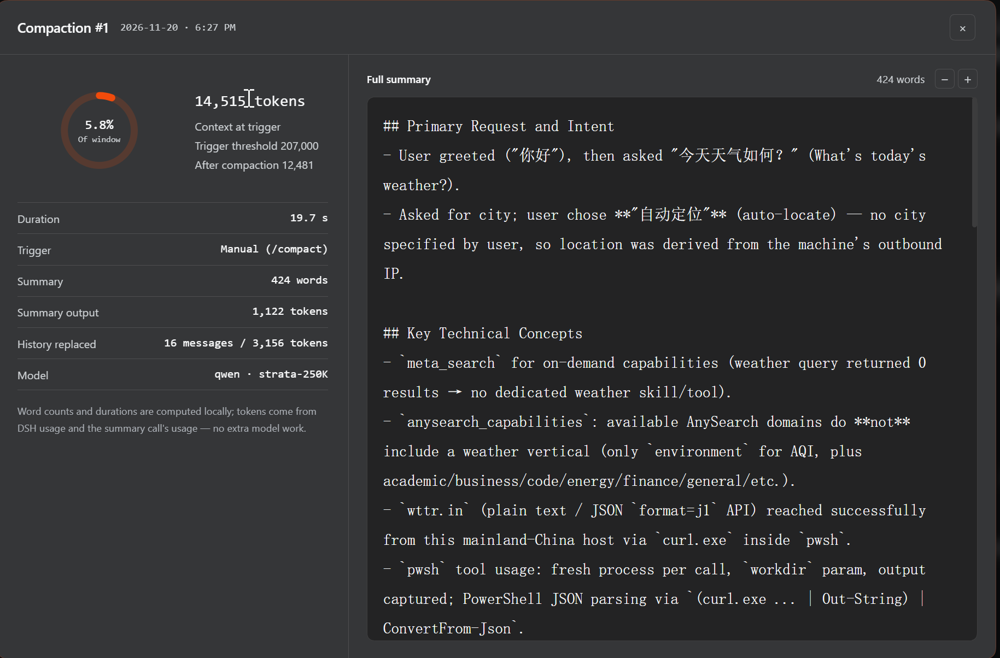

# dsh-auto-compaction

<p align="center"></p>

[中文](README.md) | English

**A session auto-compaction plugin that is friendly to local models: the trigger point is configurable, compaction does not make the local engine re-read the whole history, and the model writes a structured handoff summary from the prefix that is already cached. Trigger ratio, summary template, display style and per-preset scope are all configurable. Install it, restart DSH and it takes over; uninstall it and native DSH compaction comes back.**

<p align="center"></p>

- **No extra full prefill**: the summarization round replays the conversation's own prefix, so the provider's KV cache still hits.
- **Never interrupts a task**: it runs only on `agent/status === idle` / `turn/end` (mid-task compaction can be enabled if you would rather not risk draining the window).
- **Monotonic ratio**: the ratio applies to "usable input budget = window − reserved output", capped by the headroom, so 0–100% all mean something.
- **History stays recoverable**: it goes through DSH's own compaction transaction (`surfaceOp: replace`); old messages stay in the session log and rewind still works.
- **Editable template**: a Markdown template read on every compaction, so edits apply without a restart. One file per language (`template.md` / `template.en.md`), picked by the UI language.
- **Visible while it runs**: a live status indicator (phase, elapsed time, queued-message hint) plus a closing notice on success or failure.
- **Five progress styles**: orbit ring (default), status bar above the composer, central progress ring, top loading bar, corner card. Saved value applies from the next compaction. Every overlay uses an opaque surface, so no text bleeds through.
- **Timeline in two places**: the compaction timeline can be turned off, or shown as a bead chain on the left of the chat, or in an appended "Compaction" tab whose master-detail view lists every compaction and its summary.
- **Five timeline styles**: ember ticks (default), capsule flow, phase rings, quiet ticks, proportional bars — switchable in settings with a live preview, and all five share the same pitch/degradation rules so long histories behave consistently.

<p align="center"></p>

- **Complete summaries**: sections are validated against the template; a short answer is continued, then rewritten, and if it is still incomplete the commit is abandoned — a document that ends in "(truncated)" never replaces your history.
- **Can be switched off any time**: turning off "Enable plugin" hands compaction straight back to DSH's native implementation (native threshold and native `/compact`), with no restart and no uninstall.
- **Follows the UI language**: settings, status notices, timeline, compaction tab and detail, failure dialog all come in English when DSH is in English — 12-hour time and an English word count — and switch back to Chinese the moment you do.
- **Settings page**: `Settings → Session Compaction`. The slider snaps to 5%, the number field does not, and saving applies immediately (sidecar file).

## Changelog

- **0.5.0**: the plugin UI now follows an English DSH interface, and the summary template follows the language too.
- **0.4.0**: five looks for the compaction timeline, switchable in settings with a live preview: ember ticks (default, beads before the time like a log rail), capsule flow (newest one solid orange, largest click target), phase rings (arc length = share of the window at trigger), quiet ticks (only the rail, ticks and time; hover for duration and length), proportional bars (bar length = context share at trigger, summary length on the right). The settings section became one top-level heading with two parallel sub-sections. Also fixed preview/real-timeline mismatch, capsule overflow and scattered unsaved-field markers.
- **0.3.1**: "Trigger" in the detail view now distinguishes manual `/compact`, automatic (idle) and automatic (mid-task) instead of mislabelling mid-task as idle; − / + font-size buttons for the summary (10–24px, default 12px, persisted); the bead chain no longer caps at 420px and uses the full available height, so dozens of compactions no longer collapse the spacing early; UI copy unified on "summary".

## Packages

| Package | Role | Mounted as |
|---|---|---|
| `dsh-auto-compaction` | Settings page and status UI (bundle): `Settings → Session Compaction`, reads/writes the sidecar settings, and generates its own takeover rows on activation | profile's `dsh.profile.bundles` |
| `dsh-auto-compaction-engine` | Engine: provides `ctx.compaction`, owns triggering, summarising and replacing history | takeover rows in this package's `cordis.patch.yml`, into every agent preset |

> Since 0.2.0 the two package names are swapped: `dsh-auto-compaction` is the bundle the market installs and lists, and the engine is `dsh-auto-compaction-engine` (the old `dsh-auto-compaction-ui` is gone).

> The engine package must **never** declare `dsh.client`: DSH would mount it a second time as a profile plugin, registering `ctx.compaction` twice and failing at startup.

## How it compacts

1. Once the threshold is crossed it does **not** act immediately: it waits for the agent to finish the turn (`agent/status idle` or `turn/end`); mid-task compaction can be enabled if the window would otherwise be drained.
2. It asks the model to write the summary from the conversation's own prefix (cache hit) — no extra full prefill. Missing sections or a self-declared "(truncated)" trigger a continuation, then a rewrite.
3. DSH's compaction transaction replaces **the oldest span** with that one checkpoint message; the old messages stay in the session log and rewind can still roll it back.
4. The next turn = system prompt + tool definitions + checkpoint + the verbatim tail (native `retainRatio` default 0.16, i.e. about 16% of the window; the cut never splits a tool call from its result).

## Trigger formula

```
trigger = min( round(budget × ratio), budget − headroom )
budget  = model window − reserved output (maxTokens)
```

| Setup | Budget | Headroom | Trigger at 90% |
|---|---|---|---|
| 250K window / 20K reserved | 230,000 | 10,000 | **207,000** |
| 500K window / 20K reserved | 480,000 | 10,000 | **432,000** |

Switching model or window needs no config change; sliding the ratio to 100% simply lands on the "budget − headroom" safety cap.

## Install

From the market (recommended): install `dsh-auto-compaction`; the engine comes in as its dependency. **Restart DSH and compaction is taken over — nothing to save.** Uninstall it and native compaction returns, because the takeover rows live in this package's own patch and disappear with it.

## Relation to native compaction

There are two ways back to native, and neither touches a config file:

- **Soft switch (recommended, no restart)**: turn off "Enable plugin". The takeover rows stay, but the engine hands its automatic triggering, template and status sidecar back to the native implementation; manual `/compact` uses the native summary too.
- **Uninstall (thorough)**: the takeover rows vanish with the package and the next startup resolves every preset back to `@deepseek-ai/dsh-compaction-basic`. Verified on a real install: `dependencies` / `pnpm.overrides` / `dsh.profile.bundles` are all cleared, DSH starts normally and `/compact` answers in the native wording.

## Known limitations

- Verified on the web/desktop profile only (`dsh` 0.2.x).
- Summaries are lossy: details that never made it into the summary cannot be recovered from the context (the old messages are still in the session log for reading/rewind).
- The settings page depends on DSH's `connection.rpc`, `settings.section` and `agentPresets` services — host internals that may change in a future DSH release.

## License

MIT
