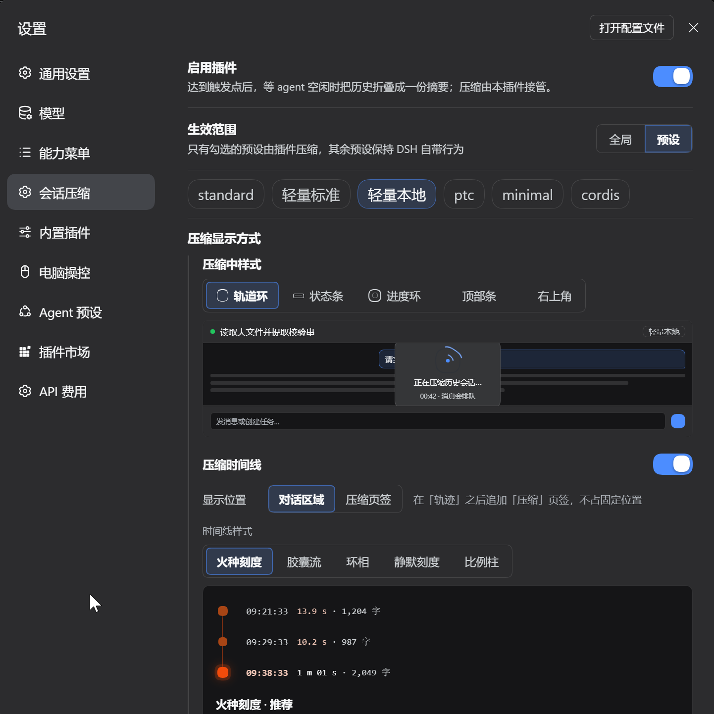
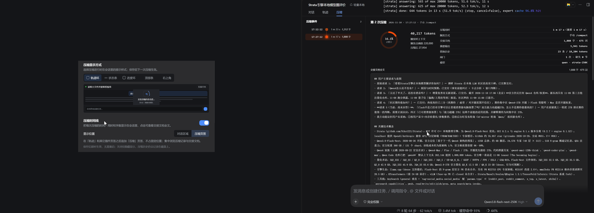

# dsh-auto-compaction

<p align="center"></p>

中文 | [English](README.en.md)

**一个对本地模型友好的会话自动压缩插件：可自定义压缩触发点，不会使本地引擎重读全部历史，并让模型基于已缓存的前缀撰写结构化交接摘要，触发比例、摘要模板、显示样式与逐预设生效范围均可配置。安装重启 DSH 后接管；卸载即恢复DSH原生压缩。**

<p align="center"></p>

- **无额外全量 prefill**：写摘要那一轮复用会话自己的前缀，命中 KV 缓存。
- **不打断任务**：只在 `agent/status === idle` / `turn/end` 时执行（可启用任务中途压缩功能，避免耗尽模型上下文窗口）。
- **比例语义单调**：比例作用于「可用输入预算 = 窗口 − 输出预留」，再受 headroom 封顶，0–100% 全程有效。
- **历史可回滚**：走 DSH 自己的压缩事务（`surfaceOp: replace`），旧消息留在会话日志里，rewind 仍可撤回。
- **模板可编辑**：外置 Markdown 模板，每次压缩时读取，改完不用重启；中英各一份（`template.md` / `template.en.md`），按界面语言取用。
- **压缩可见**：压缩期间显示状态提示（阶段、已用时间、排队提示），完成/失败有收尾提示。
- **进度样式可选**：设置页的「压缩显示方式」可选轨道环（默认）、输入区状态条、中央进度环、顶部加载条、右上角卡片；保存后下一次压缩生效。所有浮层与完成/失败状态条都用不透明表面色，背景文字不会透上来。
- **时间线可选位置**：设置页「压缩时间线」可开关，并选择显示在「对话」左侧珠链或新增的「压缩」页签；页签追加在现有页签之后，主从视图集中浏览压缩记录与摘要。
- **时间线五种样式**：火种刻度（默认）、胶囊流、环相、静默刻度、比例柱，可在设置页切换并实时预览；五种样式共用同一套节距与降级规则，压缩次数多时表现一致。

<p align="center"></p>
- **摘要完整**：按模板校验小节；缺节先续写、再重写，仍不完整就放弃提交，不会把「（截断）」的稿子替换进历史。
- **可随时停用**：设置页顶部的「启用插件」开关关闭后，压缩立即交回 DSH 原生实现（自动阈值与 `/compact` 都是原生摘要），无需重启、不卸载插件。
- **界面跟随语言**：设置页、压缩提示、时间线、压缩页签与详情、失败弹窗都跟着 DSH 的语言设置走，切英文即全英文（时间 12 小时制、字数只算英文单词），切回中文即恢复。
- **设置页**：`设置 → 会话压缩`，滑条吸附 5%、数字框不吸附，保存即生效（边车文件）。

## 更新

- **0.5.0**：界面跟随 DSH 的语言设置。DSH 切到英文后，设置页、压缩状态提示、时间线、压缩页签与详情、失败弹窗全部变成英文，切回中文即恢复——不用重启，也没有插件自己的语言开关。
  - 摘要模板分语言：中文用 `template.md`，英文用 `template.en.md`（内容即 DSH 原生英文指令，原先写死的「用简洁的中文工程表述书写」在英文版里是 `Write concise English engineering prose`）。续写/重写指令与「截断」标记也随语言。
  - 英文下时间按 12 小时制（`9:38 PM`）、时长用 `1 min 01 s`；时间线字数只算英文单词，中文仍是「汉字 + 英文单词」合计。
- **0.4.0**：压缩时间线新增五种外观，可在设置页「压缩显示方式 → 压缩时间线」里切换并实时预览：火种刻度（默认，珠在时间前，像日志轴）、胶囊流（最新一次橙色实底，点击面积最大）、环相（环形弧长表示触发时占窗口比例）、静默刻度（只显示火线、刻度与时间，悬停展开用时与字数）、比例柱（条长 = 触发时上下文占窗口，右侧显示摘要字数）。设置页的「压缩显示方式」改为一级标题，下辖「压缩中样式」与「压缩时间线」两个并列二级。同时修复了预览与真实时间线不一致、胶囊宽度溢出、详情待保存提示分散等问题。
- **0.3.1**：压缩详情里的「触发方式」现在区分三种：手动 /compact、自动（空闲时）、自动（任务中途），中途压缩不再被误标成空闲；「摘要全文」标题右侧新增 − / + 字号按钮（10–24px，默认 12px），调整后保存到设置、重启仍生效；左侧压缩时间线不再限制 420px 高度，改为用满会话可用高度，压缩次数多时也不会过早缩小间距或隐藏文字；界面文案统一为「摘要」，不再混用「交接文档」。

## 组成

| 包 | 作用 | 挂载方式 |
|---|---|---|
| `dsh-auto-compaction` | 设置页与状态提示（bundle）：`设置 → 会话压缩`，读写边车配置；并在启动时生成本包的接管行 | profile 的 `dsh.profile.bundles` |
| `dsh-auto-compaction-engine` | 引擎：提供 `ctx.compaction`，负责触发、摘要、替换历史 | 由本包 `cordis.patch.yml` 里的接管行挂进各 Agent 预设 |

> 0.2.0 起两个包名互换：`dsh-auto-compaction` 是市场里安装/显示的 bundle 包，引擎改名为 `dsh-auto-compaction-engine`（旧版 `dsh-auto-compaction-ui` 已废弃）。

> 引擎包**绝不能**声明 `dsh.client`：那会让 DSH 把它当 profile 级插件再挂一次，导致 `ctx.compaction` 重复注册、启动失败。

## 它是怎么压缩的

1. 到阈值后**不立即动手**，等 agent 结束当前回合（`agent/status idle` 或 `turn/end`）（可启用任务中途压缩功能，避免耗尽模型上下文窗口）。。
2. 用会话自己的前缀（命中缓存）让模型按模板写摘要 —— 不额外全量 prefill；缺小节或模型自己标注「截断」时，先续写、再重写。
3. 通过 DSH 的压缩事务把**最旧的这一段**历史替换成这一条检查点消息；旧消息仍在会话日志里，rewind 可回滚。
4. 下一轮上下文 = 系统提示词 + 工具定义 + 检查点消息 + 逐字保留的最近尾部（沿用原生 `retainRatio` 默认 0.16，即约 16% 窗口原文；切点不会拆散工具调用与其结果）。

## 触发点公式

```
触发点 = min( round(预算 × 比例), 预算 − headroom )
预算   = 模型窗口 − 输出预留(maxTokens)
```

| 配置 | 预算 | headroom | 90% 触发点 |
|---|---|---|---|
| 250K 窗口 / 20K 输出预留 | 230,000 | 10,000 | **207,000** |
| 500K 窗口 / 20K 输出预留 | 480,000 | 10,000 | **432,000** |

换模型或换窗口不用改配置；比例滑到 100% 也只是到「预算 − headroom」的安全上限。

## 安装

市场安装（推荐）：装 `dsh-auto-compaction` 即可，引擎作为它的依赖一起装上。**装完重启 DSH 就接管压缩，不需要点任何保存**。卸载它即回到原生压缩——接管行在本包补丁里，随包消失。

## 与 DSH 原生压缩的关系

回到原生有两条路，都不需要改任何配置文件：

- **软开关（推荐，无需重启）**：设置页关闭「启用插件」。接管行仍在，但引擎把自己的自动触发、交接模板和状态边车全部交回原生实现；手动 `/compact` 也走原生摘要。
- **卸载插件（彻底）**：接管行随包消失，下一次启动组合里各预设的提供者自然回到 `@deepseek-ai/dsh-compaction-basic`。已在真机上按市场流程验证：卸载后 profile 的 `dependencies` / `pnpm.overrides` / `dsh.profile.bundles` 三处引用清空、启动正常、`/compact` 返回原生措辞。

## 已知限制

- 只在 web/desktop profile 上验证过（`dsh` 0.2.x）。
- 摘要是有损的：没写进摘要的细节无法从上下文里找回（旧消息仍在会话日志，供人查看/rewind）。
- 客户端设置页依赖 DSH 的 `connection.rpc`、`settings.section` 与 `agentPresets` 服务，均属于宿主内部接口，宿主升级后可能变化。

## License

MIT
