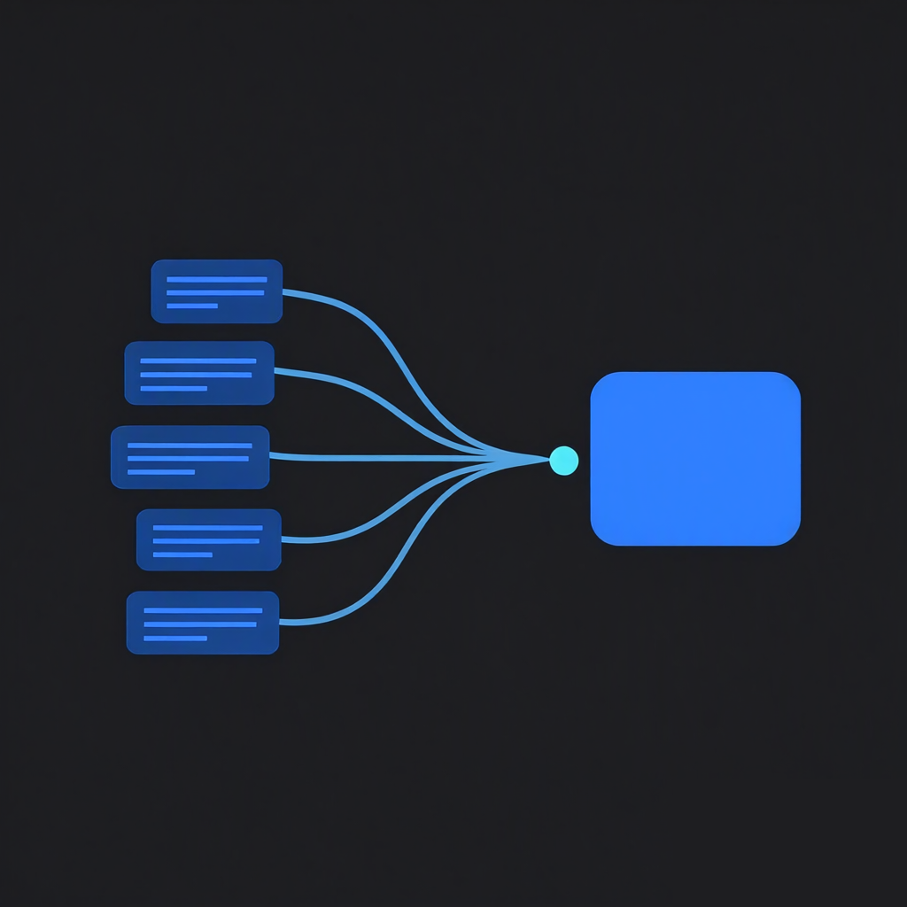
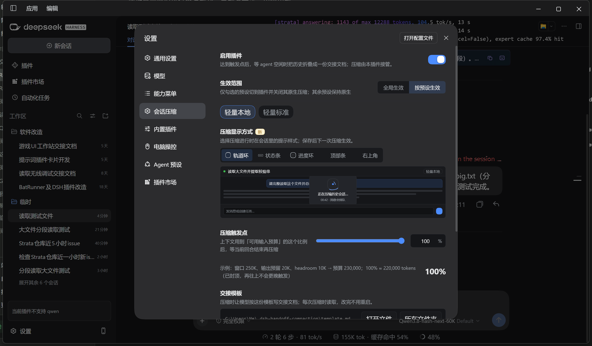

# dsh-auto-compaction

<p align="center"></p>

**一个对本地模型十分友好的会话自动压缩插件，压缩时不会触发本地模型重读历史，节约大量时间，压缩触发时机，压缩会话的保存内容可由用户自定义。**



- **无额外全量 prefill**：交接文档那一轮复用会话自己的前缀，命中 KV 缓存。
- **不打断任务**：只在 `agent/status === idle` / `turn/end` 时执行。
- **比例语义单调**：比例作用于「可用输入预算 = 窗口 − 输出预留」，再受 headroom 封顶，0–100% 全程有效。
- **历史可回滚**：走 DSH 自己的压缩事务（`surfaceOp: replace`），旧消息留在会话日志里，rewind 仍可撤回。
- **模板可编辑**：外置 Markdown 模板，每次压缩时读取，改完不用重启。
- **压缩可见**：压缩期间显示状态提示（阶段、已用时间、排队提示），完成/失败有收尾提示。
- **进度样式可选**：设置页的「压缩显示方式」可选轨道环（默认）、输入区状态条、中央进度环、顶部加载条、右上角卡片；保存后下一次压缩生效。所有浮层与完成/失败状态条都用不透明表面色，背景文字不会透上来。
- **摘要完整**：按模板校验小节；缺节先续写、再重写，仍不完整就放弃提交，不会把「（截断）」的稿子替换进历史。
- **可随时停用**：设置页顶部的「启用插件」开关关闭后，压缩立即交回 DSH 原生实现（自动阈值与 `/compact` 都是原生摘要），无需重启、不卸载插件。
- **设置页**：`设置 → 会话压缩`，滑条吸附 5%、数字框不吸附，保存即生效（边车文件）。

> English: a session auto-compaction plugin that is friendly to local models — compaction never makes the local engine re-read history, saving a lot of time; both the trigger point and the saved content of the compacted session are user-configurable.

## 组成

| 包 | 作用 | 挂载方式 |
|---|---|---|
| `dsh-auto-compaction` | 设置页与状态提示（bundle）：`设置 → 会话压缩`，读写边车配置；并在启动时生成本包的接管行 | profile 的 `dsh.profile.bundles` |
| `dsh-auto-compaction-engine` | 引擎：提供 `ctx.compaction`，负责触发、摘要、替换历史 | 由本包 `cordis.patch.yml` 里的接管行挂进各 Agent 预设 |

> 0.2.0 起两个包名互换：`dsh-auto-compaction` 是市场里安装/显示的 bundle 包，引擎改名为 `dsh-auto-compaction-engine`（旧版 `dsh-auto-compaction-ui` 已废弃）。

> 引擎包**绝不能**声明 `dsh.client`：那会让 DSH 把它当 profile 级插件再挂一次，导致 `ctx.compaction` 重复注册、启动失败。

> 0.2.3 起接管行只写在本包自己的补丁里，**不再改用户的任何配置文件**。补丁行随包安装而生效、随包卸载而消失，所以卸载后 DSH 原生压缩必然回来。

## 它是怎么压缩的

1. 到阈值后**不立即动手**，等 agent 结束当前回合（`agent/status idle` 或 `turn/end`）。
2. 用会话自己的前缀（命中缓存）让模型按模板写交接文档 —— 不额外全量 prefill；缺小节或模型自己标注「截断」时，先续写、再重写。
3. 通过 DSH 的压缩事务把**最旧的这一段**历史替换成这一条检查点消息；旧消息仍在会话日志里，rewind 可回滚。
4. 下一轮上下文 = 系统提示词 + 工具定义 + 检查点消息 + 逐字保留的最近尾部（沿用原生 `retainRatio` 默认 0.16，即约 16% 窗口原文；切点不会拆散工具调用与其结果）。

## 触发点公式

```
触发点 = min( round(预算 × 比例), 预算 − headroom )
预算   = 模型窗口 − 输出预留(maxTokens)
```

| 配置 | 预算 | headroom | 90% 触发点 |
|---|---|---|---|
| 250K 窗口 / 20K 输出预留 | 230,000 | 10,000 | **207,000** |
| 500K 窗口 / 20K 输出预留 | 480,000 | 10,000 | **432,000** |

换模型或换窗口不用改配置；比例滑到 100% 也只是到「预算 − headroom」的安全上限。

## 安装

市场安装（推荐）：装 `dsh-auto-compaction` 即可，引擎作为它的依赖一起装上。**装完重启 DSH 就接管压缩，不需要点任何保存**。卸载它即回到原生压缩——接管行在本包补丁里，随包消失。

开发态（本机 link）：

1. 把两个包 junction 到 `~/.dsh-local-pkgs/`，并在 `profiles/web/package.json` 里给两者写 `pnpm.overrides` 的 `link:`；`dependencies` 加 `dsh-auto-compaction`，`dsh.profile.bundles` 追加该包名。
2. 重启 DSH。接管行由插件在 activation 时按当前预设组合生成，不需要手工改预设文件。

接管行的形状（由 `scripts/ship-takeover-rows.mjs` 从 DSH 已安装的预设定义生成，运行时同一套生成器再算一遍）：

```yaml
- id: preset-standard          # 按 Loader 行 id 匹配；config 整键替换
  config:
    id: standard
    order: 1
    plugins:                   # 必须写全：预设的其它插件一个都不能少
      - id: compaction
        name: cordis:group
        group: true
        isolate: { compaction: true, toolResultPruner: true }
        config:
          - id: compaction-basic
            name: dsh-auto-compaction-engine
            config: { thresholdRatio: 0.9, headroomTokens: 10000, maxTokens: 12288, idleDelayMs: 1500, presetId: standard }
          - id: command-compact
            name: "@deepseek-ai/dsh-command-compact"
          - id: tool-result-pruner
            name: "@deepseek-ai/dsh-compaction-tool-result-pruner"
```

补丁 DSL 定位不到预设内部的行，只能整条替换预设行的 `config`，所以插件列表必须完整重建；`!!js` 标量（如 `disabled: !!js process.platform === 'win32'`）必须原样写回，否则跨平台条件会退化成真值字符串。无法原样重写的值一律跳过该预设并保持原生。

`scripts/preset-scope.mjs` 只保留两件事：升级时把 0.2.x 写进用户文件的旧接管残留还原成原生行（activation 自动执行一次），以及 `status` / `state` 只读排查。`enable` 不再是接管的入口。

## 配置

| 位置 | 内容 |
|---|---|
| 预设行 `config` | 默认值：`thresholdRatio` / `headroomTokens` / `maxTokens` / `idleDelayMs` / `presetId` |
| `~/.dsh-handoff-compaction/settings.json` | 设置页写入的实时值（引擎每次判定读取，按 mtime 缓存） |
| `~/.dsh-handoff-compaction/template.md` | 交接模板（缺失时按内置模板生成）；默认内容 = DSH 原生压缩指令 `COMPACTION_INSTRUCTION` 的中译版（8 个小节，唯一偏离是要求用中文工程表述书写），母本见 `docs/template-native-zh.md` |
| `~/.dsh-handoff-compaction/ui.log` | 设置页 RPC 与「打开文件」诊断日志 |

设置页的「生效范围」默认**全局生效**；切到「按预设生效」时，下面的预设名单来自 DSH 的 `agentPresets` 注册表（内置 `standard / ptc / minimal / cordis` + 第三方预设 + 用户自定义预设），**默认全不勾选**。勾选与否不改变补丁文件：接管行始终挂在每个预设上，是否真的接管由引擎在判定时按 `presetId` 决定——没被选中的预设，其 `compactIfNeeded` / `summarize` / `compactNow` 全部委派 `@deepseek-ai/dsh-compaction-basic`，行为与没装插件时逐字等价。因此改勾选、改开关都是运行时生效，不需要重启。

### 当前生效情况

设置页里「当前生效情况」排在「生效范围」下面，**只检测、不切换**，三个数各自对应一件不同的事实：

- `covered`：本包补丁里的接管行覆盖到哪些预设（写入过）；
- `mounted`：**本次启动的组合里**该预设的压缩提供者已经是我们引擎的那些（已生效）——刚写入的行要下次启动才出现在这里；
- `effective`：再叠加「启用插件」开关与生效范围勾选，真正由插件压缩的数量。

圆点文案：`DSH 原生压缩` / `DSH 原生压缩（插件已停用）` / `n/6 预设已由插件压缩` / `已由插件接管` / `已由插件接管（全局）` / `读不到预设`。逐预设状态标为「插件」「原生（未勾选）」「原生（未覆盖）」。读不到时右侧给一个「重新读取」，它只重新检测、不写任何文件。

跳过某个预设时原因会写进说明小字，例如 `no-group: 没有可接管的 compaction 组`、`risky: 含无法原样重写的值（plugins[1].config.computed）`——不会静默少接管一个预设。

`enabled`（默认 `true`）是设置页顶部的开关：引擎每次判定都读取，写盘后下一次判定即生效。关闭时引擎不再挂交接文档，把 `compactIfNeeded` / `summarize` / `compactNow` 全部交回 `@deepseek-ai/dsh-compaction-basic`，即 DSH 原生压缩；设置页同时也隐藏状态提示。

## 与 DSH 原生压缩的关系

回到原生有两条路，都不需要改任何配置文件：

- **软开关（推荐，无需重启）**：设置页关闭「启用插件」。接管行仍在，但引擎把自己的自动触发、交接模板和状态边车全部交回原生实现；手动 `/compact` 也走原生摘要。
- **卸载插件（彻底）**：接管行随包消失，下一次启动组合里各预设的提供者自然回到 `@deepseek-ai/dsh-compaction-basic`。已在真机上按市场流程验证：卸载后 profile 的 `dependencies` / `pnpm.overrides` / `dsh.profile.bundles` 三处引用清空、启动正常、`/compact` 返回原生措辞。

从 0.2.x 升级上来时，插件会在 activation 检测并**一次性还原**旧机制写进用户文件的接管残留（预设里的 `handoff:slot` 块、profile 根节点的 `handoff:native-guard`），因为两套提供者同时挂进同一个 realm 会直接 `service "compaction" has been registered` 启动失败。还原记录在 `settings.json` 的 `legacyRevertedAt`，之后不再重复执行。

## 已知限制

- 只在 web/desktop profile 上验证过（`dsh` 0.2.x）。
- 补丁层顺序 = `dsh.profile.bundles` 数组顺序，而接管行是「更新一个已存在的预设行」。所以本包的条目必须排在声明该预设的包之后：插件会在 activation 把自己挪到数组末尾（实测覆盖从 4/6 变成 6/6）。仍有一个一次启动的滞后——**在本插件之后新装的预设包**，要下一次 activation 才被覆盖，设置页用 `covered` 与 `mounted` 两个数如实区分这两件事。
- 桌面市场安装不会把包写进 `dsh.profile.bundles`（只写 `dependencies` / `overrides` / generation 投影），所以这一步由插件自己做；卸载时市场会连带清掉该条目，不会留下「声明了却装不起来」的启动风险。
- 交接文档是有损的：没写进文档的细节无法从上下文里找回（旧消息仍在会话日志，供人查看/rewind）。
- 客户端设置页依赖 DSH 的 `connection.rpc`、`settings.section` 与 `agentPresets` 服务，均属于宿主内部接口，宿主升级后可能变化。

## 开发

```bash
node --test packages/dsh-auto-compaction-engine/test/   # 引擎：plan / summary / integration / preset-scope / takeover-rows
node --test packages/dsh-auto-compaction/test/          # bundle：activation 挂载与接管行生成
node packages/dsh-auto-compaction/scripts/ship-takeover-rows.mjs --presets <DSH 安装目录>/presets
```

发版前用 `--check` 确认包内接管行与当前安装的 DSH 预设定义仍然一致。

## License

MIT
